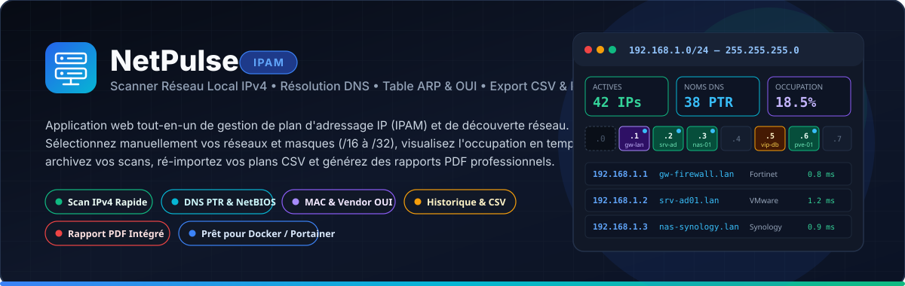
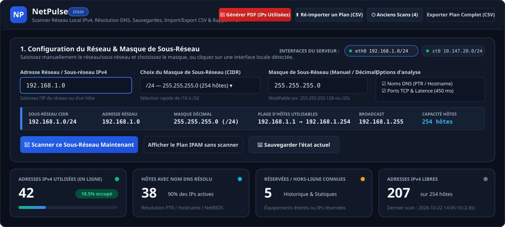
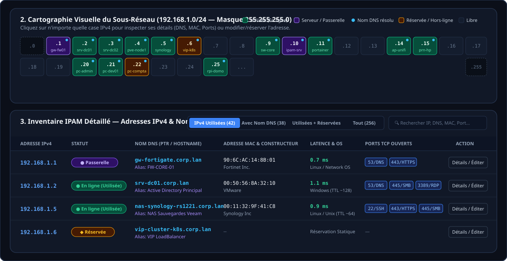
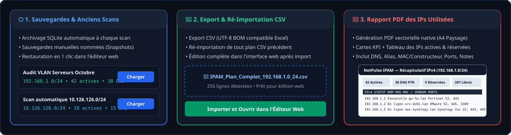

<div align="center">



# 🌐 NetPulse IPAM

**Scanner Réseau Local IPv4 • Résolution DNS • Table ARP & Constructeurs OUI • Historique & Sauvegardes • Export/Import CSV & Rapport PDF**

[](https://www.python.org/)
[](./docker-compose.yml)
[](https://www.sqlite.org/)
[](#architecture--structure-du-projet)

</div>

---

## 📋 Présentation

**NetPulse IPAM** est une application web légère et autonome de **gestion de plan d'adressage IP (IPAM)** et de **découverte de réseaux locaux IPv4**. Conçue sans aucune dépendance Python externe, elle démarre instantanément sous **Docker / Portainer**, **Linux** ou **Windows**.

Elle permet aux administrateurs système et réseau de :
1. **Choisir manuellement le réseau, le sous-réseau et le masque** (`/16` à `/32` ou notation décimale pointée `255.255.255.0`), ou sélectionner en un clic une des interfaces détectées sur le serveur.
2. **Scanner rapidement le réseau local** (Ping ICMP multi-threadé + inspection de la table ARP + scan des ports TCP courants) pour identifier toutes les **adresses IPv4 utilisées**.
3. **Résoudre automatiquement les noms DNS** (`PTR` inverse, `FQDN`, `NetBIOS` / `LLMNR` / `mDNS`) et identifier le **constructeur matériel (OUI)** via l'adresse MAC.
4. **Sauvegarder l'historique des scans**, **exporter / ré-importer des plans complets en CSV** pour les modifier dans l'interface web, et **générer un rapport PDF récapitulatif** des adresses IPv4 utilisées.

---

## 🖼️ Aperçu de l'Interface

### 1. Sélection du Sous-Réseau, Calculateur CIDR & Indicateurs KPI
> Sélectionnez ou saisissez n'importe quel réseau/sous-réseau et masque (`/16` à `/32`), visualisez instantanément la plage d'hôtes utilisables et suivez le taux d'occupation du réseau.



---

### 2. Cartographie Visuelle (Grille IPAM) & Inventaire Détaillé
> Chaque adresse IPv4 du sous-réseau est représentée sous forme de grille interactive colorée (*Utilisée*, *Serveur/Passerelle*, *Nom DNS résolu*, *Réservée/Hors-ligne*, *Libre*). Cliquez sur n'importe quelle case ou ligne du tableau pour éditer son alias, son rôle, son statut ou ses notes.



---

### 3. Sauvegardes d'Anciens Scans, Ré-Import CSV & Rapport PDF
> Archivez automatiquement chaque scan, restaurez d'anciens états, ré-importez un fichier CSV exporté précédemment pour le modifier dans l'application web, et téléchargez un rapport PDF A4 Paysage prêt à être partagé.



---

## ✨ Fonctionnalités Détaillées

| Catégorie | Fonctionnalités incluses |
| :--- | :--- |
| **🌐 Réseau & Masque Manuel** | • Saisie libre de l'adresse réseau/sous-réseau IPv4<br>• Sélecteur de masque `/16` (`255.255.0.0`) à `/32` (`255.255.255.255`) + saisie manuelle décimale ou CIDR<br>• **Calculateur de sous-réseau intégré** : Adresse réseau, Broadcast, 1re/Dernière IP, Nombre d'hôtes<br>• Détection automatique des interfaces locales du serveur (`eth0`, `ens18`, `ZeroTier`, etc.) |
| **⚡ Moteur de Scan Hybride** | • **Ping ICMP parallèle** (jusqu'à 96 threads simultanés) avec mesure de la latence en `ms`<br>• **Lecture de la table ARP** (`arp -a`, `/proc/net/arp`, `ip neigh`) : détecte même les hôtes dont le pare-feu bloque l'ICMP<br>• **Identification du Constructeur (Vendor OUI)** à partir de l'adresse MAC + détection des MAC aléatoires/privées (LAA)<br>• **Estimation de l'OS et du Rôle** via le `TTL` et les ports ouverts (Windows, Linux/Unix, Équipement réseau, NAS, Imprimante, VM) |
| **🔍 Résolution DNS** | • Résolution DNS inverse standard (`PTR` via `gethostbyaddr`)<br>• Résolution `FQDN` et fallback `NetBIOS / LLMNR`<br>• Possibilité de définir un **Alias personnalisé** et de forcer/compléter le nom DNS dans l'IPAM |
| **🔌 Scan des Ports TCP** | • Détection rapide des services ouverts : `21/FTP`, `22/SSH`, `23/Telnet`, `53/DNS`, `80/HTTP`, `135/RPC`, `139/NetBIOS`, `443/HTTPS`, `445/SMB`, `3389/RDP`, `8080/HTTP-Alt`, `8443/HTTPS-Alt`, `9100/Printer` |
| **🕒 Historique & Sauvegardes** | • Sauvegarde automatique dans SQLite à la fin de chaque scan et lors de chaque import CSV<br>• Création de **sauvegardes manuelles nommées** (*Snapshots*)<br>• **Restauration en 1 clic** d'un ancien scan dans l'éditeur web |
| **🔄 Export & Ré-Import CSV** | • Export CSV des **IPs utilisées** ou du **Plan complet** (encodage UTF-8 avec BOM pour ouverture directe dans Microsoft Excel)<br>• **Ré-importation complète** d'un fichier CSV/JSON exporté précédemment afin de le modifier directement dans l'interface web |
| **📄 Génération PDF Native** | • Générateur PDF 1.4 vectoriel intégré (format **A4 Paysage multi-pages**, zéro dépendance externe)<br>• Inclut le bandeau récapitulatif du sous-réseau, les 4 cartes KPI et le tableau complet des adresses IPv4 utilisées/réservées |

---

## 🐳 Déploiement sur Portainer (Recommandé)

Le projet inclut un [`Dockerfile`](./Dockerfile) et un fichier [`docker-compose.yml`](./docker-compose.yml) prêts pour un déploiement direct via les **Stacks Portainer**.

### Étapes dans Portainer :

1. Connectez-vous à **Portainer** et ouvrez votre environnement Docker.
2. Dans le menu latéral, cliquez sur **Stacks** puis sur **+ Add stack**.
3. Configurez la stack :
   - **Name** : `netpulse-ipam`
   - **Build method** : sélectionnez **Repository**
   - **Repository URL** : `https://github.com/CDE76/NetPulse.git`
   - **Repository reference** : `refs/heads/main`
   - **Compose path** : `docker-compose.yml`
4. *(Optionnel)* Ajoutez des variables d'environnement dans la section **Environment variables** :

| Variable | Valeur par défaut | Description |
| :--- | :--- | :--- |
| `PORT` | `8095` | Port d'écoute du serveur web NetPulse IPAM (bascule automatiquement sur un port libre si occupé) |
| `IPAM_ADMIN_USER` | `admin` | Identifiant administrateur créé au premier démarrage |
| `IPAM_ADMIN_PASSWORD` | `admin123` | Mot de passe initial (modifiable ensuite directement dans l'interface web) |
| `IPAM_FORCE_ENV_PASSWORD` | `0` | Mettre à `1` pour forcer la réinitialisation du mot de passe avec `IPAM_ADMIN_PASSWORD` |
| `TZ` | `Europe/Paris` | Fuseau horaire pour l'horodatage des scans et rapports PDF |
| `IPAM_DATA_DIR` | `/data` | Répertoire interne du volume persistant SQLite |

5. Cliquez sur **Deploy the stack**.
6. Ouvrez votre navigateur sur : **`http://<IP-DE-VOTRE-SERVEUR-DOCKER>:8080`**

### Contenu du `docker-compose.yml` :

```yaml
services:
  netpulse-ipam:
    build:
      context: .
      dockerfile: Dockerfile
    container_name: netpulse-ipam
    restart: unless-stopped
    network_mode: host
    cap_add:
      - NET_RAW
      - NET_ADMIN
    environment:
      - PORT=${PORT:-8080}
      - IPAM_DATA_DIR=/data
      - TZ=${TZ:-Europe/Paris}
    volumes:
      - ipam_data:/data

volumes:
  ipam_data:
    driver: local
```

> [!IMPORTANT]
> **Pourquoi `network_mode: host` ?**
> Pour qu'un conteneur Docker puisse scanner le réseau local réel (LAN), envoyer des requêtes ARP et lire la table ARP physique de l'hôte (`/proc/net/arp`), il doit partager la pile réseau de l'hôte Docker via `network_mode: host`. Sans cela, le conteneur ne verrait que le sous-réseau virtuel isolé du bridge Docker (`172.17.0.0/16`).

---

## 💻 Installation Locale (Sans Docker)

### Sous Linux / macOS :
```bash
git clone https://github.com/CDE76/NetPulse.git
cd NetPulse
python3 app.py 8080
```

### Sous Windows :
```powershell
git clone https://github.com/CDE76/NetPulse.git
cd NetPulse
# Double-cliquez sur start_ipam.bat ou lancez :
python app.py 8080
```
Puis ouvrez **[http://localhost:8080](http://localhost:8080)** dans votre navigateur.

---

## 🔌 API REST Intégrée

L'application expose une API JSON simple utilisable pour vos scripts ou automatisations :

| Méthode | Endpoint | Description |
| :--- | :--- | :--- |
| `GET` | `/api/interfaces` | Retourne les interfaces locales détectées, les sous-réseaux connus et l'historique |
| `GET` | `/api/subnet-calc?network=192.168.1.0&mask=255.255.255.0` | Calcule les informations CIDR, plage d'hôtes, masque et broadcast |
| `POST` | `/api/scan` | Lance un scan asynchrone (`network`, `mask`, `timeout_ms`, `resolve_dns`, `scan_ports`) |
| `GET` | `/api/scan/status` | Retourne la progression en temps réel du scan en cours |
| `GET` | `/api/ipam?network=192.168.1.0&mask=255.255.255.0` | Retourne les statistiques KPI, la grille visuelle et tous les enregistrements IPAM |
| `POST` | `/api/ipam/update` | Modifie ou réserve une adresse IPv4 (alias, DNS, statut, rôle, notes) |
| `GET` | `/api/history` | Liste les anciens scans et sauvegardes enregistrés |
| `POST` | `/api/history/save` | Sauvegarde manuellement un snapshot nommé de l'état actuel |
| `POST` | `/api/history/restore` | Restaure un ancien scan dans le plan IPAM actif |
| `POST` | `/api/import/plan` | Ré-importe un fichier CSV ou JSON complet dans la base IPAM |
| `GET` | `/api/export/csv?network=...&mask=...&only_used=0` | Télécharge le plan complet (`only_used=0`) ou les IPs utilisées (`only_used=1`) en CSV |
| `GET` | `/api/export/pdf?network=...&mask=...` | Génère et télécharge le rapport PDF A4 Paysage des adresses IPv4 utilisées |

---

## 📁 Architecture & Structure du Projet

```text
NetPulse/
├── app.py                  # Serveur HTTP multi-threadé, API REST, base SQLite & Import CSV
├── scanner.py              # Moteur de scan IPv4 (Ping ICMP, Table ARP, DNS PTR, Ports TCP)
├── oui_db.py               # Base d'identification des constructeurs réseau (MAC OUI)
├── pdf_generator.py        # Générateur natif de rapports PDF A4 Paysage
├── static/
│   ├── index.html          # Interface Web NetPulse IPAM
│   ├── styles.css          # Thème sombre responsive & grille IPAM
│   └── app.js              # Logique frontend (temps réel, filtres, modales, import/export)
├── assets/                 # Illustrations et aperçus visuels de la documentation
├── Dockerfile              # Image Docker Python 3.12-slim + outils réseau Linux
├── docker-compose.yml      # Stack prête pour Portainer (network_mode: host + volume /data)
└── start_ipam.bat          # Lanceur rapide sous Windows
```
